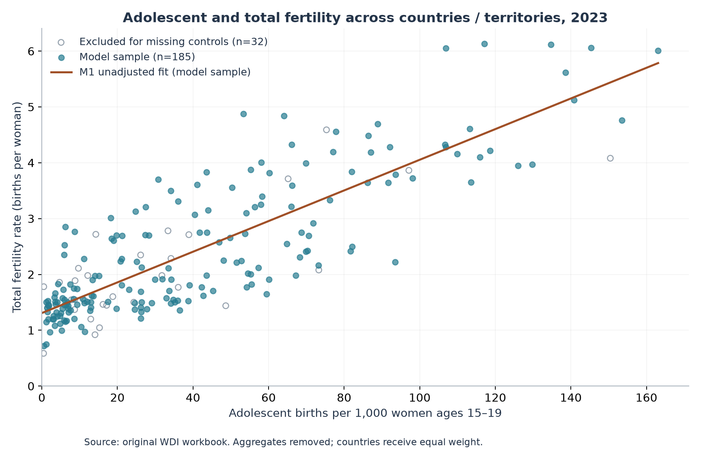
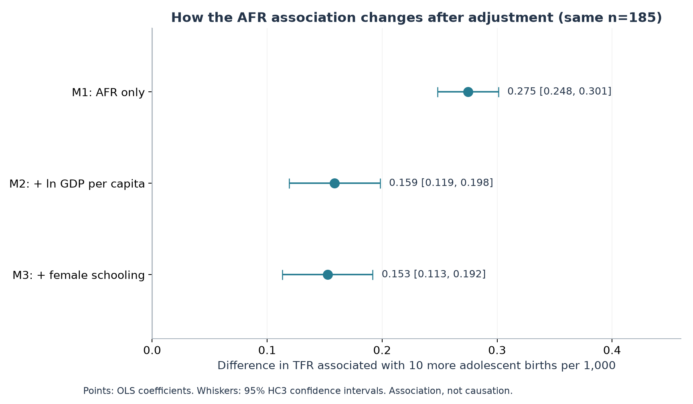
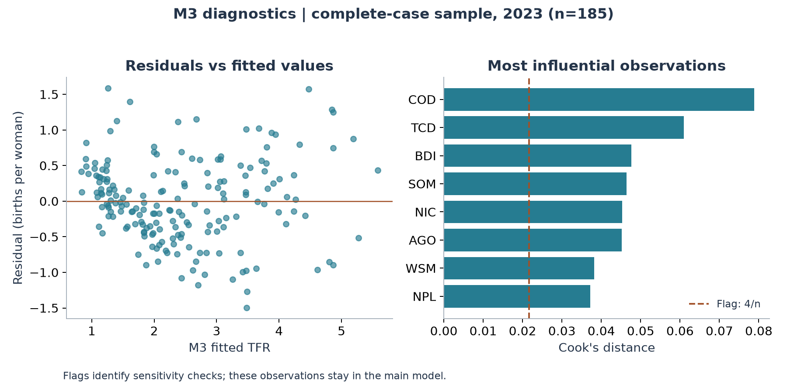

# Adolescent Fertility and Total Fertility
## A 2023 cross-country reanalysis of the MDM4U project

Review version · October 2026 · Original project preserved separately

### Abstract

This study revisits the relationship between adolescent fertility and total fertility using the original project's 2023 World Development Indicators (WDI) observations. Regional and income aggregates are removed, leaving 217 countries and territories. Three ordinary least squares models use the same 185 complete cases and sequentially add log PPP GDP per capita and female mean years of schooling. The association with 10 additional adolescent births per 1,000 women falls from 0.275 to 0.153 births per woman, a descriptive attenuation of 44.4%. The adjusted association remains positive (95% HC3 confidence interval 0.113–0.192). Female schooling adds little incremental fit after GDP and adolescent fertility are included. These findings describe an ecological association; they do not identify the effect of adolescent dating norms or of policies intended to discourage teenage relationships.

### 1. Research question

How much of the cross-country association between adolescent fertility and total fertility remains after adjustment for economic development and female education?

The motivation comes from a broader question about whether discouraging adolescent romantic relationships might affect later family formation. This dataset has no direct measure of that cultural attitude or of individuals' relationship histories. Adolescent childbearing is an outcome shaped by many processes and cannot be treated as a validated measure of approval of adolescent dating. The empirical question is therefore narrower than the original motivation.

### 2. Data and sample

The original workbook contains 266 geographic entries, of which 264 have both fertility measures. Forty-nine entries are regional, income or other aggregates, including the empty “Not classified” entry. Excluding these yields 217 countries and territories with both fertility measures. Aggregate status is determined from the original country metadata's blank Region field; the omitted metadata entry INX is explicitly classified as “Not classified.” Unique country codes and one-to-one joins are required throughout.

The dependent variable is total fertility rate (TFR), in births per woman. The main predictor is adolescent fertility rate (AFR), in annual births per 1,000 women ages 15–19. Original fertility values are retained. GDP per capita is measured in purchasing power parity, constant 2021 international dollars, and transformed using the natural logarithm. Education is UNDP's published 2023 mean years of schooling for women ages 25 and above. That series includes estimates based on surveys conducted in different years.

Twenty of the 217 entries lack usable 2023 GDP, and 25 lack female schooling; 13 lack both. Complete-case analysis therefore uses 185 entries, excluding 32. No missing values are imputed and no nearby-year values are substituted. Excluded entries have mean TFR 2.018 compared with 2.438 among included entries; missingness is not assumed to be random. Every exclusion is listed in `data/processed/all_rows_audit.csv`.

The original fertility download and new controls have different release vintages. All 217 country/territory AFR values match the current WDI 2023 series; TFR matches for 200 of 217, with a maximum absolute revision of 0.170 births per woman. A same-sample refreshed-data sensitivity is reported below. The main results preserve the original fertility data to isolate the methodological upgrade.

### 3. Method

The three specifications are:

```text
M1: TFR = intercept + b1 AFR + error
M2: TFR = intercept + b1 AFR + b2 ln(GDP per capita) + error
M3: TFR = intercept + b1 AFR + b2 ln(GDP per capita) + b3 female schooling + error
```

All three use identical complete cases, so coefficient changes do not arise from changing sample membership. Countries and territories receive equal weight. HC3 heteroskedasticity-robust standard errors and normal-reference 95% confidence intervals are used. R² and adjusted R² describe in-sample fit, not causal explanatory power or out-of-sample predictive performance.

Controls summarize two development dimensions; they are not claimed to form a sufficient causal adjustment set. Education, income and fertility may influence each other. We inspect variance inflation factors, residuals, and Cook's distance, and report supplemental region, influence and data-vintage checks. These exploratory models are not preregistered causal tests.

### 4. Results

| Model | n | AFR association per +10 births/1,000 [95% HC3 CI] | R² | Adjusted R² |
|---|---:|---:|---:|---:|
| M1: AFR | 185 | 0.275 [0.248, 0.301] | 0.699 | 0.697 |
| M2: + ln GDP per capita | 185 | 0.159 [0.119, 0.198] | 0.780 | 0.777 |
| M3: + female schooling | 185 | 0.153 [0.113, 0.192] | 0.782 | 0.779 |


The unadjusted association on all 217 cleaned observations is 0.270 births per woman per 10 additional adolescent births per 1,000 (R²=0.692). The original mixed country-plus-aggregate sample reproduces the reported overall R² of approximately 0.715 (n=264). The comparable complete-case baseline is M1, not the mixed-row result.

Adding GDP reduces the AFR coefficient substantially. Female schooling produces a smaller further reduction. Comparing M1 with M3 on the same sample, the AFR coefficient falls by 44.4%; this percentage describes a change in the fitted coefficient, not a proportion of a causal effect explained by development.

In M3, the coefficient on ln GDP is −0.420 (95% HC3 CI −0.579 to −0.262). Doubling GDP corresponds to an estimated −0.291 births per woman at fixed AFR and schooling, within this fitted cross-sectional model. The schooling coefficient is −0.032 births per woman per additional year (95% CI −0.080 to 0.016; p=0.191). This interval does not establish an independent schooling association, nor does it establish that education is irrelevant. GDP and education overlap statistically: VIFs are 2.67 for AFR, 4.08 for ln GDP and 3.41 for schooling. Adjusted R² rises only from 0.777 to 0.779 when schooling is added to M2.





### 5. Sensitivity and diagnostics

Seventeen observations exceed the Cook's-distance screening threshold 4/n. They remain in the main model. Excluding them only as a sensitivity leaves n=168 and an AFR coefficient of 0.01474 per one birth per 1,000, compared with 0.01525 in M3. Adding categorical indicators for the original World Bank regions gives 0.01625. Replacing the original fertility values with the freshly retrieved WDI 2023 series on the same 185 entries gives 0.01528. The positive AFR association persists in these specifications; this does not remove omitted-variable bias.

TFR partly includes adolescent fertility by construction. For five-year age groups, the adolescent contribution is approximately 5 × AFR / 1,000 = 0.005 × AFR. We examine the arithmetic residual `TFR − 0.005 × AFR`. The M3 AFR coefficient becomes 0.01025 (95% HC3 CI 0.00633–0.01418). This is an accounting adjustment, not an independent robustness test: subtracting a multiple of a regressor necessarily reduces its slope by exactly that multiple and leaves other slopes unchanged. Because the published fertility indicators may combine different underlying sources, the residual is an approximation, not a separately measured adult fertility rate. It is not completed cohort fertility.



The residual plot shows systematic structure and unequal dispersion, suggesting that the simple linear model is an incomplete description. HC3 addresses heteroskedasticity in the standard-error calculation; it does not correct functional-form errors, measurement errors, regional dependence or omitted variables. The models summarize an average linear association across heterogeneous societies.

### 6. Interpretation and limits

The core descriptive finding survives the upgrade: places with more adolescent childbearing tend to have higher period total fertility, including after adjustment for these two development measures. Its magnitude is smaller after adjustment. This is consistent with overlapping development patterns, but does not identify their mechanisms.

The observations are countries and territories in a single year. They cannot establish how a person discouraged from dating as a teenager later forms relationships, whether a cultural norm changes fertility over time, or how Chinese gender relations develop. Contraception, marriage patterns, urbanization, costs of parenthood, religion, institutions and many other factors are unmeasured. Period TFR is a synthetic annual measure and need not equal a cohort's eventual family size. Robust intervals do not include uncertainty in the source estimates, and cross-country dependence is not modeled.

Legal marriage age is excluded from the upgraded main models: the original legal table is labelled June 2013, its parental-consent definitions differ, and the two supplied workbooks contain discrepancies. It would also be an indirect indicator of adolescent dating attitudes. The original CSE-profile subset is not treated as an added control: restricting to countries with a profile does not estimate an effect of CSE. Differences between subgroup correlations alone do not establish moderation.

### 7. Conclusion

A modest multivariable extension improves the original project through cleaner observations, a fixed comparison sample, development controls, uncertainty reporting and reproducibility. It supports a narrower claim about cross-country fertility patterns. The proposed link from negative attitudes toward adolescent dating to lower later fertility remains a separate hypothesis requiring direct measures and time-ordered evidence.

### Sources and reproducibility

1. Original input: `data/raw/original_data.xlsx`, copied without modification from `MDM4U Culminating Data.xlsx`. The original location is `/Users/jerryhu/Documents/Year1/Data/`. The “Countries with CSE profile” sheet explicitly labels both fertility columns 2023; all corresponding entries were checked against the “Data” sheet. Workbook update date: 19 December 2025.
2. [World Bank: adolescent fertility definition](https://databank.worldbank.org/metadataglossary/world-development-indicators/series/SP.ADO.TFRT), indicator `SP.ADO.TFRT`.
3. [World Bank: total fertility definition](https://databank.worldbank.org/metadataglossary/world-development-indicators/series/SP.DYN.TFRT.IN), indicator `SP.DYN.TFRT.IN`.
4. [World Bank: PPP GDP per capita](https://data.worldbank.org/indicator/NY.GDP.PCAP.PP.KD), indicator `NY.GDP.PCAP.PP.KD`; 2023 observations, constant 2021 international dollars. API snapshot updated 8 October 2026.
5. [UNDP Human Development Report 2025 downloads](https://hdr.undp.org/data-center/documentation-and-downloads): composite-indices time series, column `mys_f_2023`; codebook and Table 4 archived alongside the CSV. Female mean schooling concerns ages 25+. This is the published 2023 series, which includes estimates and inputs from earlier surveys, not a synchronized 2023 survey of every country.

Exact download URLs, UTC retrieval times and SHA-256 hashes are in `data/source_manifest.json`. Raw downloads are retained; the analysis does not require a fresh download.

`Analysis.ipynb` contains saved, executed outputs; `Analysis.html` is its reading copy. `scripts/analyze.py` rebuilds the cleaned data, regression tables and figures from archived inputs. The main OLS coefficients and HC3 covariance matrix were independently recalculated with NumPy. Source files in the original folder are checked against their initial SHA-256 hashes.
